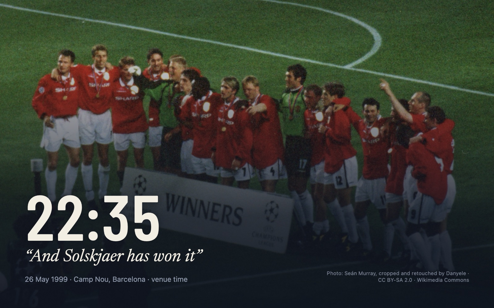

# Sporting Moments Clock

A clock for macOS that tells the time with famous sporting moments. Each minute it shows a moment that happened at that time of day: the current time, a one line caption, and a photo when a properly licensed one exists.

It runs as a screen saver, as a full screen desk clock, and from the menu bar.



Modelled on the literature clock, which shows a book quote for every minute of the day.

## Install

1. Download `SportingMomentsClock-1.0.dmg` from the Releases page.
2. Open it and drag the app to Applications.
3. Open the app and click Use as Screen Saver. It installs the screen saver and selects it.
4. If the app says it could not select it, choose Sporting Moments Clock in System Settings, under Wallpaper (Screen Saver on older versions of macOS).

Requires macOS 14 or later. Runs on Apple silicon and Intel.

## What it shows

Three layers decide what fits a minute.

* **Real time.** The moment appears at the clock time it happened at the venue. Solskjaer's winner in Barcelona shows at 22:35. A setting switches this to your own time zone.
* **Records.** A record appears when the clock reads its digits. Bolt's 9.58 shows at 09:58 and a 2:01:39 marathon at 02:01. Famous numbers work the same way: 755 home runs at 07:55.
* **Match minute fill.** Off by default. A 93rd minute goal shows at 33 minutes past any hour. It covers every minute, but the link to the time of day is weak.

When nothing matches a minute, the previous moment stays up. The big clock is always the current time.

With the default layers, 1,240 of the 1,440 minutes of the day have a moment.

## How accurate the times are

Most times are worked out, not documented. A football goal is placed at kickoff plus the match minute, with allowances for stoppage and half time, and is good to a few minutes. Race finishes are a scheduled start plus the winning time. A small number are documented to the minute. A card kept from an earlier minute says "around" its time.

The research notes in `docs/` say how each kind of time was arrived at and what is not verified.

## Build it yourself

You need Xcode, XcodeGen and Python 3.11 or later.

```
python3 pipeline/build_data.py        # builds build/moments.json from the CSV files in data/
cd app
xcodegen generate
xcodebuild -scheme SportingMomentsClock -derivedDataPath build build
```

Tests:

```
python3 -m unittest discover pipeline/tests
cd app && xcodebuild test -scheme SportingMomentsClock -derivedDataPath build -destination 'platform=macOS'
```

`dist/make_release.sh` builds the signed disk image. It needs your own Developer ID.

## Layout

* `data/`: the moments and records as CSV files, with corrections kept as separate override files.
* `pipeline/`: the Python build that turns the CSV files into one JSON file, and its tests.
* `app/`: the Swift code. A shared core, the menu bar app, and the screen saver.
* `docs/` and `research/`: findings from the research phase and the scripts behind the data. The cached Wikipedia pages those scripts read are not included.

## Credits and licences

The code is under the MIT licence. See `LICENSE`.

The photos are not covered by that licence. Almost all come from Wikimedia Commons and a few from Flickr, each under its own licence, mostly Creative Commons Attribution or Attribution ShareAlike, and some in the public domain. Every photo's author, licence and source page is listed in `data/overrides/images.csv`, `images_other.csv` and `images_related.csv`, and in the app's Credits window. Some cards show a photo of the athlete or venue from another day, not the moment itself; their credit begins "Pictured:" and says who and when. If you reuse a photo, follow its licence.

The fonts are Barlow Condensed and Newsreader, under the SIL Open Font License.

Times, dates and results were compiled from Wikipedia and the sources recorded against each moment.
